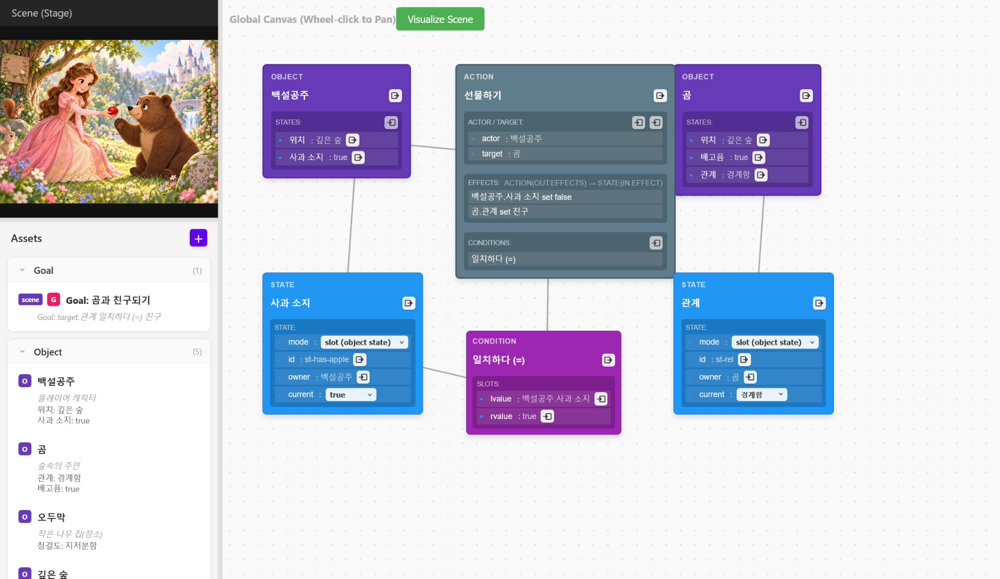
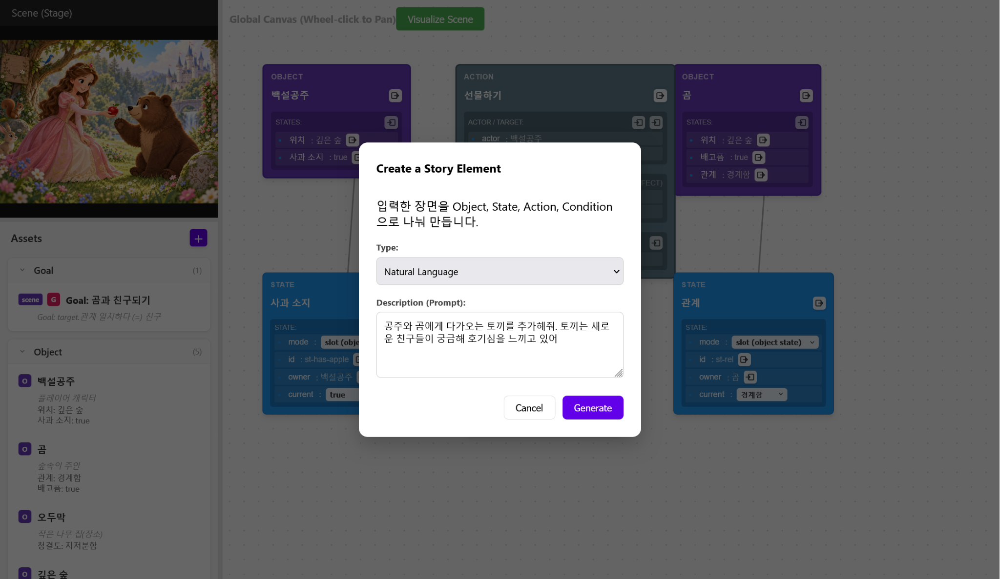
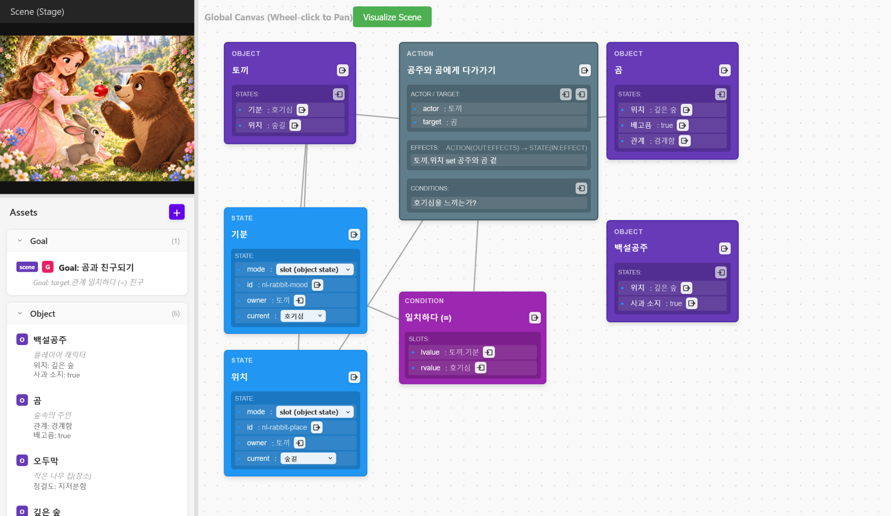
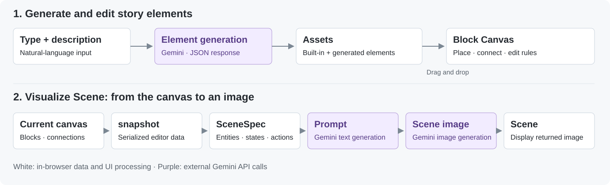

# Interactive Story Maker

### A creative coding tool for building stories, connecting rules, and visualizing scenes

Interactive Story Maker is a web tool designed to help children express **relationships between states, conditions, actions, and outcomes** as they create characters and events. Users describe a character's traits in natural language, then use blocks to define who does what and what should change as a result. AI-generated scene images help them see the context of the story they have built.

**Final project for GIST's Intelligent Agent course · Individual project**  
React · JavaScript · SVG · Gemini API

## Contents

- [Features and Workflow](#features-and-workflow)
- [Story Data Model](#story-data-model)
- [System Architecture](#system-architecture)
- [Technical Decisions and Implementation](#technical-decisions-and-implementation)
- [Implemented Features](#implemented-features)
- [Development Setup](#development-setup)
- [Code Structure](#code-structure)

## Features and Workflow

The interface has three areas: **Scene**, **Assets**, and **Block Canvas**. Scene displays the image, Assets holds the story elements, and Block Canvas lets users connect relationships between those elements.

<table>
  <tr>
    <th width="33%">1. Build a Scene and Its Rules</th>
    <th width="33%">2. Describe a New Element</th>
    <th width="33%">3. Review the Blocks and Scene</th>
  </tr>
  <tr>
    <td><a href="assets/img/01-scene-rules.png"></a></td>
    <td><a href="assets/img/02-natural-language-input.png"></a></td>
    <td><a href="assets/img/03-rabbit-scene.png"></a></td>
  </tr>
  <tr>
    <td>Connect characters, states, and actions</td>
    <td>Describe a new character and its behavior</td>
    <td>Review the added rules and visualized scene</td>
  </tr>
</table>

These UI mockups illustrate the flow from natural-language input to block editing and scene review. Click an image to view it at full size.

### 1. Connect Characters and Actions with Blocks

The first screen shows Snow White giving an apple to a bear. Snow White's `Has Apple` and the bear's `Relationship` are represented as states, while `Give Gift` specifies the action's actor and target. The conditions describe whether Snow White has an apple; the effects describe how apple possession and the bear's relationship should change.

- Drag elements such as Object, State, Action, and Condition from Assets onto the canvas.
- Use ports to connect characters to the states they own, assign actors and targets, and attach conditions to actions.
- Move blocks or pan the canvas to inspect relationships, then edit properties and action rules in the editor.

### 2. Add Story Elements with Natural Language

Users can draft a story element by describing a character or object in natural language. In the generation dialog, they select a type from Object, State, Action, Condition, or Goal and enter a description. An Object request returns a bundle containing the Object and its initial States, which are added to Assets.

The rabbit example breaks a situation into a character, states, an action, and a condition: a curious rabbit approaches Snow White and the bear.

### 3. Review the Added Rules and Scene Together

The final screen contains the rabbit's `Mood` and `Location` states and an `Approach Snow White and the Bear` action. The condition is `Mood = Curious`, and the effect expresses a rule that changes the rabbit's location to beside Snow White and the bear. The Scene panel on the left shows an image that includes the rabbit.

Scene visualization is requested with the **Visualize Scene** button. The current canvas is summarized as a scene specification and passed into the image-generation flow. After editing a rule, users can request another image based on the updated canvas.

## Story Data Model

The model separates characters from actions so users can add conditions and effects. For example, “give the bear an apple” can have the condition “must have an apple” and the intended outcome “become friends with the bear.”

| Element | What It Represents | Gift-Giving Example |
| --- | --- | --- |
| **Object** | A character, item, or place, with references to its states | Snow White, bear, apple, deep forest |
| **State** | A property definition and its possible values, or a current value associated with an object | Has Apple: true/false; Relationship: Wary/Friend |
| **Action** | An action with an Actor, a Target, conditions, and effects | Snow White gives a gift to the bear |
| **Condition** | An expression that compares states or values | Snow White's Has Apple = true |
| **Effect** | An intended state assignment resulting from an action | Has Apple = false; the bear's Relationship = Friend |
| **Goal** | A target condition and an ending description | Become friends with the bear |

State values distinguish Booleans, literals, Object references, and other value types. For example, `Has Apple` is a Boolean, while `Location` can refer to a place Object. Conditions can compare a state with a constant or compare states belonging to different objects.

### Example: A Gift-Giving Rule

In this example, Snow White and the bear each have a Location state. The `Give Gift` action from the built-in data uses Snow White as its Actor and the bear as its Target.

| Part | Rule |
| --- | --- |
| Actor and Target | Actor = Snow White; Target = bear |
| Condition 1 | Actor and Target have the same Location |
| Condition 2 | Actor's Has Apple is true |
| Effect 1 | Set Actor's Has Apple to false |
| Effect 2 | Set Target's Relationship to Friend |

A Condition describes **which state to check**, while an Effect describes **which state to assign and what value to use**. Effects are state-assignment rules stored within an Action. Users connect Conditions to actions, then review and edit the conditions and effects in the Action editor.

Related code: [Built-in story data](src/data/initialData.js), [Element editor](src/components/ComponentEditor.js)

## System Architecture



The app consists of a React client that calls the Gemini API. It has separate paths for generating story elements and visualizing edited content. Built-in example data lets users drag blocks from Assets and construct rules without first requesting new elements.

### Story Element Generation

1. Enter an **element type and description** in the generation dialog.
2. `generateGameElement()` sends Gemini a request that includes the JSON format for the selected type.
3. Parse the response as either a single element or a bundle containing an Object and its initial States.
4. Add the result to Assets, where users can drag the elements they need onto the canvas and edit them.

### Scene Visualization

1. `exportCanvasSnapshot()` creates a snapshot of the current blocks and connections.
2. `buildSceneSpec()` extracts character, state, and action information from the snapshot to build a scene specification.
3. `generateImagePrompt()` turns that specification into descriptions of the characters, actions, and setting needed for an image.
4. `generateSceneImage()` requests an image using the prompt.
5. Convert the returned image data into a Data URL and display it in the Scene panel.

SceneSpec contains `entities`, `initial_state`, `actions`, and `render_hint`. It passes **who is present, their states, and the actions defined for them** to the image request, rather than the canvas coordinates or connection lines. `initial_state` collects the current values of State blocks in slot mode that have an assigned owner. Conditions and effects come from the data stored in each Action.

Related code: [Snapshot export](src/api/exportCanvasSnapshot.js), [SceneSpec construction](src/api/sceneSpec.js), [Visualization flow](src/components/BlockCanvas.js)

## Technical Decisions and Implementation

### 1. Natural Language as an Editable Draft: Gemini and JSON Responses

Users need freedom to describe story characters and objects, while the editor needs structured fields such as names, properties, and ownership. The solution is to receive **type-specific JSON drafts from natural-language descriptions**.

Each request includes the selected type and required field structure, with Gemini's response MIME type set to `application/json`. Object requests ask for at least one initial State. The returned bundle is split into an Object and States, each receives an identifier, and the elements are added to Assets. Other types are handled as single elements.

Generated content is treated as **draft data for the user to edit**. `FileGenerator` handles the request, loading and error indicators, and adding results. Users then review and revise those results in the editor. Response-parsing failures and API connection failures are reported separately.

Related code: [Type-specific prompts and JSON handling](src/api/llmApi.js), [Generation dialog and result handling](src/components/FileGenerator.js)

### 2. Making Connections Meaningful: React, SVG, and Typed Ports

Connecting a character to a State establishes ownership; connecting it to an Action assigns an Actor or Target. Custom blocks and ports for Object, State, Action, and Condition make these different relationships explicit in the interface.

React state holds the canvas blocks and connections. Each block card displays the inputs and ports required by its type, while SVG lines show relationships between blocks. Block dragging and canvas panning use the same coordinate and state model.

`isAllowedConnection()` checks the combination of source and destination blocks and ports. These four connection types update the corresponding data:

- **Object → State:** Assign the State's owner
- **Object → Action:** Assign the Actor or Target reference
- **Object's State → Condition:** Specify the object and property to compare
- **Condition → Action:** Add a copy of the condition expression to the Action's conditions when connected

A Condition → Action connection copies the expression into the Action at the time of connection. The conditions applied to the Action can then be reviewed and edited in the Action editor.

Within conditions and effects, `actor` and `target` are role references to the Action's Actor and Target.

Related code: [Allowed connections](src/components/blocks/blockGraph.js), [Connection-driven data updates](src/components/BlockCanvas.js), [Type-specific block content](src/components/blocks/BlockContents.js)

### 3. Visualizing the Context of Edited Rules: SceneSpec and Two-Stage Generation

The canvas holds both editing metadata, such as positions, identifiers, and ports, and story content, such as characters, states, and actions. **SceneSpec** is an intermediate representation that carries the story content into image generation.

In the [scene visualization flow](#scene-visualization), converting a snapshot to SceneSpec resolves Object and State identifiers to names and formats action conditions and effects as strings.

| Editor Data | Representation in the Scene Specification |
| --- | --- |
| Object identifier | Character name and ID |
| State with an assigned owner and current value | `Snow White.Has Apple`, `true` |
| Action's Actor and Target references | `Snow White`, `bear` |
| Effect's state reference and assigned value | `actor.Has Apple set false` |

A text model uses the specification to create an image prompt describing the characters' appearance, actions, and surroundings. An image model then generates the scene. The flow separates editor-data summarization, visual description, and image generation. When users change rules, another visualization request reads the current canvas and repeats the process.

During image generation, duplicate requests are blocked and the returned image is displayed in Scene. If a request fails, the app displays an error and clears the loading state.

Related code: [SceneSpec](src/api/sceneSpec.js), [Image prompts](src/api/llmApi.js), [Image response handling](src/api/nanobanana.js), [Scene display](src/components/Scene.js)

## Implemented Features

- Story element generation and browsing, Object/State/Action/Goal editing, and dragging elements from Assets onto the canvas
- Type-specific block placement, movement, and deletion; port connections; and editing of states and action rules
- Conversion of the current canvas into SceneSpec, image-generation requests, and display of the result in Scene
- Built-in story examples, with loading and error handling for generation and visualization requests

## Development Setup

### Technologies

| Area | Technology | Used For |
| --- | --- | --- |
| UI | React 19, JavaScript, CSS | Assets, generation and editing dialogs, Block Canvas, and Scene |
| Relationship display | SVG | Connection lines between blocks |
| AI integration | `@google/genai` | Requests for story elements, prompts, and images |
| Text generation | `gemini-2.0-flash` | JSON element generation and image-prompt generation |
| Image generation | `gemini-2.5-flash-image` | Scene image generation |
| Development and build | Create React App, `react-scripts` | Development server, build, and test scripts |

### Run Locally

Install Node.js and npm, then start the development server:

```bash
git clone https://github.com/hemaher0/interactive-story-maker.git
cd interactive-story-maker
npm ci
npm start
```

Once the server starts, open [http://localhost:3000](http://localhost:3000). Assets initially contains the built-in examples.

1. Drag the characters, states, and actions you need from Assets onto the canvas.
2. Assign the characters' states and each Action's Actor and Target, then edit the conditions and effects.
3. To create more elements, click `+` in Assets and enter a type and description.
4. Click **Visualize Scene** to request an image.

### API Configuration

AI element and image generation require a Gemini API key with access to the models listed above. To experiment with generation locally, set the key in the `MY_API` placeholders in `src/api/llmApi.js` and `src/api/nanobanana.js`.

The app calls the Gemini SDK directly from the browser, so keep any source containing a key local. For a public deployment, move API calls and key management to a server so the key is not exposed in the client.

### Scripts

| Command | Purpose |
| --- | --- |
| `npm start` | Start the development server |
| `npm run build` | Create a static production build in `build/` |

## Code Structure

```text
src/
├── App.js                         # Assets and Scene state; overall layout
├── data/initialData.js             # Example Objects, States, Actions, Conditions, and Goals
├── components/
│   ├── Hierarchy.js               # Assets list and entry points for generation and editing
│   ├── FileGenerator.js           # Type and description input; AI result handling
│   ├── ComponentEditor.js         # Element properties; Action conditions and effects
│   ├── BlockCanvas.js             # Block placement, connections, and visualization requests
│   ├── blocks/                    # Block cards, ports, connection rules, and value display
│   ├── hooks/useBlockDragger.js    # Block dragging
│   └── Scene.js                   # Generated scene image display
└── api/
    ├── llmApi.js                  # Story element and image-prompt generation
    ├── exportCanvasSnapshot.js    # Canvas snapshot export
    ├── sceneSpec.js               # Story data summarized as a scene specification
    └── nanobanana.js              # Scene image requests and response handling
```
